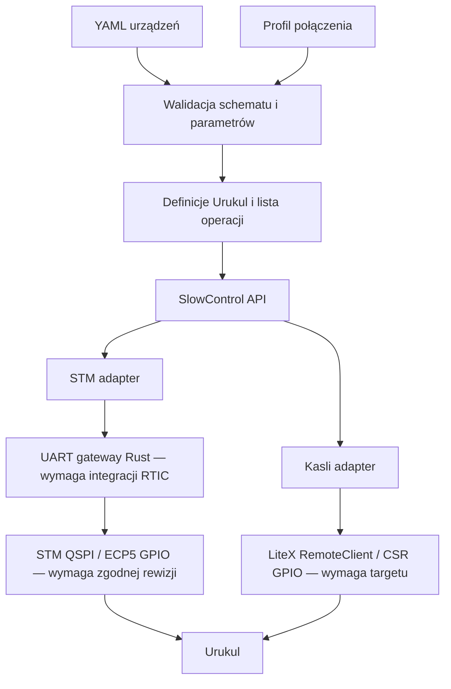

# Architektura i decyzje

## ADR-001: host interpretuje YAML

JSON Schema Draft 2020-12 + walidacja semantyczna w Python 3. YAML ma numer
wersji 1, odrzucane nieznane pola i powtórzone klucze. Jednostki są jawne;
attenuation jest liczbą dziesiętną z `dB`. MCU nie parsuje YAML.

Konfiguracja urządzeń nie zawiera adresu IP, pinów ani CSR. Osobny profil
połączenia wiąże logiczne `id` z endpointem i pinami. Slot w YAML jest logiczną
lokalizacją kasety; endpoint jest adresem kontrolera, nie numerem slotu EEM.
Dzięki temu ten sam plik urządzeń jest używany z obydwoma adapterami.

## ADR-002: jeden mały API, brak RTIO

Aktualny transport SPI jest bit-bangingiem GPIO przez hosta, mode 0, MSB-first,
z trzema bitami adresu CS dekodowanymi w CPLD. Jest wolny, nie ma gwarancji
minimalnej/maksymalnej latencji. Wykorzystuje istniejące magistrale/CSR.
Nie powstaje nowy Ethernet stack. To etap sprawdzania zgodności operacji;
w produkcji całe transakcje SPI muszą być wykonywane lokalnie na kontrolerze.

Rejestry GPIO określa profil, nie wbudowana mapa zgadywana z README. ABI magic
`0x53434731` jest kontraktem nowego obrazu, a nie identyfikatorem upstream.
STM odrzuca kompatybilność przez `RegisterBus::compatible()` do czasu integracji
zweryfikowanego adaptera QSPI. Kasli wymaga jawnego CSR ABI. Ani obecne firmware
STM, ani standardowy ARTIQ nie implementują tego ABI.

## ADR-003: mały, prawdziwy zakres Urukul

Współdzielona jest logika kodowania tłumików i CPLD status, oparta na
`artiq/coredevice/urukul.py`, a nie dekoratory kernel czy transport RTIO.
Model operacji nie obejmuje DDS/AD9910/AD9912. Każda z czterech wartości tłumienia
jest obowiązkowa, więc nie nadpisujemy pozostałych kanałów nieznaną wartością.
Wektor 10/20/31.5/0 dB daje słowo `ff035faf`, kanal 0 w najmłodszym bajcie.

Odczyt statusu protokołu 8 równocześnie zapisuje CFG. CFG=0 wyłącza bity RF,
ale zmienia też wybór clock/profile/reset; nie jest operacją zachowującą
konfigurację aktywnego ARTIQ. Demonstrator wymaga modułu oddanego do wyłącznej
obsługi slow control. Nie wolno współdzielić GPIO/SPI z eksperymentem.

Konfiguracja najpierw poleca wyłączenie RF wszystkim modułom, później sprawdza
protokół i zapisuje tłumiki. Jest sekwencyjna, bez atomowego rollbacku. Awaria
wywołuje próbę wyłączenia RF i maksymalnego tłumienia wszystkich modułów.
Niepowodzenie tej próby jest raportowane, a nie ukrywane jako sukces.

## API i semantyka

| Operacja | Aktualne zachowanie |
|---|---|
| discover | Zadeklarowane ID z YAML; jawnie nie skan fizyczny |
| identify | SPI status CPLD, sprawdzenie protocol 8; nie odczyt rewizji PCB |
| read | Status CPLD i cztery tłumiki (shift + ponowne zatrzaśnięcie); DDS UNSUPPORTED |
| write | Pełny walidowany wektor czterech tłumików; ponowna konfiguracja całego systemu z RF-off |
| configure | RF-off, attenuation, odczyt i porównanie rejestrów |
| reset | Polecenia safe-state; nie fizyczny reset kontrolera |
| status | Stan bieżącej sesji hosta; brak zdalnego trwałego stanu |
| health | Identyfikacja ABI i jawny status symulacji/autonomii |

`configured_registers_verified` oznacza odczyt zgodnych rejestrów tłumików,
nie pomiar wyjść RF. W symulacji jest zawsze oznaczony `simulated=true`. `safe_commanded_unverified` również nie potwierdza stanu elektrycznego.
Stan CLI znika wraz z procesem. `health.autonomous_safe_state=false` zawsze.

Błędy: INVALID_CONFIG, NOT_FOUND, UNSUPPORTED, INCOMPATIBLE_ABI,
IDENTITY_MISMATCH, READBACK_MISMATCH, PROTOCOL, TRANSPORT, TIMEOUT, HARDWARE. Zapisy po timeout mają
`outcome_uncertain=true`. Zero automatycznych retries zapisów i resetów.
UART po błędzie jest nieużywalny do ponownego otwarcia; numery sekwencji chronią
przed pomyleniem odpowiedzi. GPIO SPI ma deadline całej transakcji, a operacje
transportu własny timeout. Cleanup jest best-effort i może przedłużyć deadline
o jeden timeout transportu. Utrata zasilania/hosta w połowie ramki nie ma
obecnie gwarantowanej ścieżki bezpieczeństwa.

## ADR-004: autonomia jest brakiem, nie obietnicą

Zatrzaski modułu i GPIO utrzymują ostatni stan bez nowych poleceń, lecz to nie
jest pełna autonomia. Brakuje przechowywania zatwierdzonej konfiguracji na
kontrolerze, watchdogu lokalnego, transakcji SPI i pewnego safe-state po resecie.
Dopóki te funkcje nie powstaną, całość pozostaje częściowym demonstratorem.

## ADR-005: MODULIQ później

Pozostawić ESPHome. Możliwy adapter hostowy walidowanego modelu do jego native
API lub MQTT; brak założenia identycznych topików Miniconf/ESPHome. Wspólne mogą
być jednostki, ID, metadane telemetrii, kody błędów i narzędzia diagnostyczne.
Nie generować firmware ESPHome ani mieszać pinów DIOT z ESP32. Nie znaleziono
w przekazanych materiałach konkretnej konfiguracji urządzeń MODULIQ, więc
integracja nie jest wdrożona ani testowana.

## Mostek Kasli jako etap pośredni

`gateware/kasli_uart_gpio.py` jest minimalnym targetem LiteX z platformą Migen,
UARTbone i różnicowym EEM. Nie ma CPU, DDR ani Ethernetu i nie jest wariantem A.
Pozwala sprawdzić transport bez kosztu pełnego firmware. v1.0 używa clk50,
pozostałe rewizje clk125_gtp/ODIV2 (62.5 MHz). Bufory mają stałe kierunki;
CSR OE jest konwencją hosta, nie tri-state dla LVDS. Nie przejmuje żadnych
wspólnych pinów RTIO. Mapowanie wymaga zewnętrznego pliku z reviewed=true.
Generacja HDL dla v1.0/v1.1/v2.0/v2.1 PASS; synteza i routing v2.1 PASS z mapą
syntetyczną. Napięcie konfiguracji i zewnętrzne constraints nadal wymagają
weryfikacji. Nie wygenerowano bitstreamu. Preferowany produkcyjny serwis
bare-metal ma wykonywać operacje SPI i watchdog lokalnie.

Odczyt tłumików w obecnym adapterze tymczasowo zatrzaskuje zeros, następnie
przywraca odczytany łańcuch. RF musi pozostawać OFF. Upstream potrafi zachować
CS między dwoma transferami; optymalizacja tego zachowania wymaga lokalnego SPI.

## ADR-006: maksymalnie wspólny rdzeń firmware

Zgodnie z preferencją użytkownika współdzielenie ma obejmować kod wykonywany
na kontrolerach, nie tylko format YAML i hostowe definicje. Docelowo jedna
biblioteka Rust no_std zawiera sterowniki modułów, kodowanie transakcji,
sekwencje inicjalizacji, stan konfiguracji, błędy, timeouty i politykę safe-state.
Nie zależy ona od stm32h7xx-hal, RTIC, adresów CSR ani konkretnego softcore.
Host pozostaje w Pythonie i kompiluje YAML do prostego planu operacji.

Rdzeń korzysta z małego interfejsu endpointów: submit transakcji, sprawdzenie
zakończenia, odbiór danych i dostęp do GPIO. STM realizuje go przez QSPI do
ECP5, Kasli przez MMIO wewnętrznej magistrali FPGA. Czekanie i deadline są
sterowane wspólną logiką; szczegóły monotonicznego zegara i IRQ dostarcza
platforma. Nie powstają dwa niezależne sterowniki Urukul.

Oddzielne pozostają startup/linker, zegary, HAL, QSPI/DMA STM, MMIO/IRQ Kasli
oraz integracja stosu sieciowego. Sieci także można współdzielić, jeśli istniejący
stos i koszty portowania to uzasadnią; nie wymagamy tego na początku.
Wspólny firmware nie wymusza pełnego wspólnego gateware. Można współdzielić
lokalne mastery SPI/FIFO i kontrakt rejestrów, pozostawiając specyficzne dla FPGA
bufory I/O, reset/CDC i upstream bridge oddzielnie.

Rust jest preferencją wynikającą z istniejącego firmware STM i zamiaru
współdzielenia, nie wymaganiem narzuconym niezależnie od wyników portowania.
Przed zatwierdzeniem docelowego softcore trzeba zbudować i połączyć tę samą
bibliotekę no_std dla STM Cortex-M7 i wybranego CPU Kasli oraz sprawdzić runtime
bez alokatora. Kompilacja obecnego rdzenia na hoście nie potwierdza tego kroku.
Minimalny target UARTbone bez CPU jest jedynie narzędziem uruchomieniowym;
nie będzie uruchamiał wspólnego firmware.

Kolejność pozostaje: odtworzyć istniejący STM baseline, zweryfikować HW,
następnie wydzielić wspólny rdzeń i wdrożyć cienkie adaptery obu platform.

## Reuse istniejącego Kasli Linux — 2026-10-12

Zweryfikowano lokalny kasli-v11-linux, nie Kasli-SoC ARM. Istnieją dowody
fizycznego Linux/DDR na KASLI01 i boot Ethernet/TFTP SMP4 PASS. Przejmujemy
platformę, CRG, LiteDRAM, LiteEth i boot/rootfs z tego projektu bez pisania
własnego stosu. Bare-metal pozostaje opcją, nie warunkiem demonstratora.
Wspólny rdzeń Rust ma backend STM no_std/QSPI oraz Kasli Linux z dostępem
do endpointów MMIO przez kontrolowany interfejs systemowy. Dodanie endpointów
wymaga regeneracji gateware/CSR map/DTB i testów; aktualnego obrazu nie
traktujemy jako gotowego slow-control. Źródła dowodów: evidence/kasli-linux-reuse.json.

## Kandydat ESPHome jako warstwa komponentów

Po ograniczeniu urządzeń do GPIO/SPI i I2C poprzez most SPI oceniamy
ESPHome/C++ jako wspólny runtime komponentów. PoC host wykorzystuje
SPIBus/SPIDelegate, GPIOPin i I2CBus. Endpointy fizyczne i FPGA mogą pozostać
wspólne dla STM/Kasli, ale integracji transportu jeszcze nie wykonano.
C++ komponenty sensora bez zmian już publikują wartości z modeli.
Rdzeń Rust jest zachowany; nie zakładamy FFI ani natywnego portu STM jako
gotowych. Decyzja docelowa zależy od Kasli cross-build i autonomii STM.

Wspólną logiką FPGA jest `SlotPinMux` z masterem MiSoC/SpiInterface z STM. CSR transport oraz bufory i translatory pozostają zależne od kontrolera. Przypisania SPI wybieramy przy budowie, GPIO/SPI przełączamy przez offline/maskę; dowolny runtime crossbar nie jest zaimplementowany. Profile muszą ograniczać mapowanie do fizycznych kierunków PCB. [PINMUX](docs/PINMUX.md).

Automat kierunków STM/Kasli i CSR są zaimplementowane oraz symulowane; integracja banku/padów/arbitrażu i testy elektryczne pozostają otwarte. [Stan i ograniczenia](docs/PINMUX.md).

ABI4: wspólny SlowControlFabric/MiSoC dla8 slotów. Osobny bank słów16 pod0x800 steruje48 górnymi liniami slotów1–6; STM ma serial595, Kasli direct. Idle masterów + data.re blokują apply, busy/apply blokują legacy writes. OE ma jedno źródło aktywnej maski; IRQ bazuje na OE i jest blokowane podczas aktualizacji. RegisteredSelectCSRBank zachowuje słowa/writes z MiSoC, rejestruje selekcję odczytu, nie samą wartość; wartości statusów są aktualne w cyklu odpowiedzi. SPI master i most pozostają upstream. Klient hosta Directions używa word-addressed ABI4, bez retry apply. Probe RTT to diagnostyka baseline, nie docelowy serwis. ESPHome/C++ pozostaje docelowym kierunkiem platform; Rust zachowany do uruchomienia HW. [Szczegóły](docs/PINMUX.md).

Flash FPGA jest oddzielną operacją maintenance, z własnym YAML i profilem połączenia. Host/API deleguje algorytmy NOR do flashrom; STM implementuje wyłącznie SPI-only serprog nad dedykowanym SPI1. Alternatywą jest zewnętrzny flashrom SPI albo openFPGALoader JTAG. Obie drogi używają tego samego backup/patch/full-readback i wspólnego locka płyty. API HTTP obecnie działa na hoście. Docelowy ESPHome może zachować protokół narzędzia; port runtime nie jest deklarowany jako wykonany. [FPGA_FLASH](docs/FPGA_FLASH.md).

## Publiczne adresy GPIO modułów — 2026-10-17

Wspólna konwencja dla driverów modułów (Sampler, Zotino oraz przyszłych
adapterów ESPHome Urukul i Matrix32_2): `funkcja: {slot: 1, line: 3}`.
Sloty1..8, linie0..15; numeracja jest niezależna od FPGA, obudowy i CSR.
Adresy transportowe pozostają w profilu kontrolera. Indeks sprzętowego
banku STM to `slot - 1`. Istniejący hostowy Urukul nadal korzysta ze swojego
profilu magistrali; nie dodano mu pozornego adaptera ESPHome.

Obecne endpointy Samplera/Zotino obsługują jeden slot. Jawny pin z innego
slotu jest błędem konfiguracji; nie należy go sprowadzać do samego numeru
linii. Zakresy, unikalność funkcji i dozwolone kierunki są walidowane przed
otwarciem transportu. Profile zdolności elektrycznych są właściwością
konkretnego builda/połączenia, a nie deklaracją drivera.

Impulsy CNV/LDAC/IO_UPDATE są dodatkowymi funkcjami GPIO, niezależnymi od
CS magistrali SPI. Sampler ma dwie różne grupy SPI (ADC i PGIA). Obecny
jednomasterowy fabric slotu nie powinien być deklarowany jako pełne
sprzętowe przyspieszenie obu naraz. Działający driver GPIO Samplera wykonuje
CNV oraz konwersję/odczyt pod blokadą endpointu. Lokalny sekwencer FPGA
oraz profil kierunków STM pozostają zadaniami przed HIL.

## Istniejące routery SPI MODULIQ — 2026-10-17

Potwierdzono oba komponenty `addrspi`/`addrspi2` w repozytorium
codex-hil/esphome-components, gałąź feature/mixed-signal-head, commit
287274ec757c8fc1a277e9535e6a0876dd9afb59. Wykorzystać je nad bazowym
SPI/GPIO STM/Kasli. Bez nowego routera. Szczegóły oraz ograniczenie pustej
transakcji CS MAX31855 przez router szeregowy: docs/ADDRESSED_SPI.md.
Audyt źródeł; brak implementacji backendu dla tej karty i brak nowego HIL.

## Standardowe komponenty ESPHome nad FPGA — 2026-10-17

Dodano `sinara_gpio`: GPIOPin o numerze np. `"7_15"`, INPUT/OUTPUT,
inwersja, walidacja slotu/kierunku i RMW zachowujący inne linie.
Bazowy SPI używa istniejącego ESPHome bitbang nad tymi pinami; adapter
utrzymuje blokadę/deadline ramki i invaliduje odczyt MAX31855 po awarii.
Piny i routery obsługuje ten sam interfejs co ESPHome na ESP32.
Przypięte `addrspi`/`addrspi2` MODULIQ pozostają niezmienione; standardowy
MAX31855 nie został skopiowany ani zmodyfikowany.

ESPHome host + addrspi +8 MAX31855: compile/runtime PASS przez model STM
PTY oraz realny LiteX RemoteServer localhost z modelem Kasli. Osiem adresów,
ujemne/dodatnie temperatury,32bit, puste CS, zachowanie innych GPIO i NaN
po utracie transportu PASS. `tools/test_all.py` i dotychczasowy demonstrator
MAX31865/LM75B PASS. Wszystkie temperatury syntetyczne, brak HIL.

To nadal hostowy adapter SCG1, nie natywny runtime STM/Kasli ani sprzętowy
SPI FPGA. Sprzętowe górne linie STM slotów1..6 odrzucone do integracji
ABI4/595. Kierunki fizyczne wymagają sprawdzonego profilu. addrspi2 zachowuje
wymaganie hardware SPI i nie jest objęty tym demonstratorem. Kolejny krok:
adapter lokalnego mastera SPI pod tym samym API, integracja kierunków i HIL
rzeczywistej karty. Szczegóły: [ESPHOME_GPIO_SPI](docs/ESPHOME_GPIO_SPI.md).

## SCF5: wspólny rdzeń, różne przyłącza

`queued_fabric.py` jest wspólną implementacją dla obu FPGA. Wishbone
oddziela go od QSPI STM i CPU Kasli. `queued_spi.py` wykorzystuje istniejący
MiSoC SPIMachine; kolejki przechowują komendy i dane, nie sterowanie RTIO.
`control_signals.py` realizuje wspólną barierę triggerów i fail-closed
interlock; `fabric_pinmux.py` przełącza grupę SPI/GPIO. Mapa tras i tryb
adresowania wynikają z profilu builda, nie z dowolnej dynamicznej matrycy.
`platform_adapters.py` oddziela fizyczne I/O i sterowanie zewnętrznym 595.

SCF5 ma osobne magic/ABI od SCG1. Klient sprawdza identyfikator profilu;
nie wykonuje automatycznego powtórzenia operacji o nieznanym wyniku.
Konfiguracja urządzeń ESPHome pozostaje wspólna, połączenie i fizyczny
profil kontrolera są osobne. Adapter ESPHome działa obecnie na host;
portable C++ HAL/MMIO jest podstawą przyszłego natywnego portu.
Szczegóły rejestrów i czasów: docs/SCF5.md.
